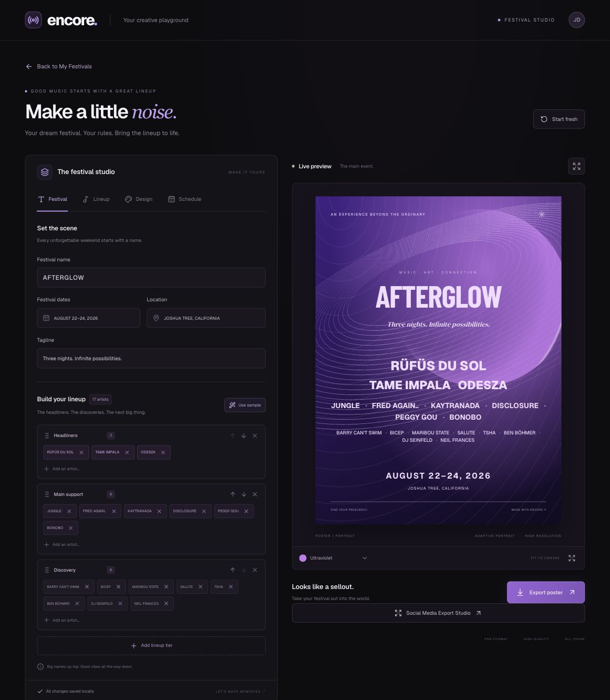
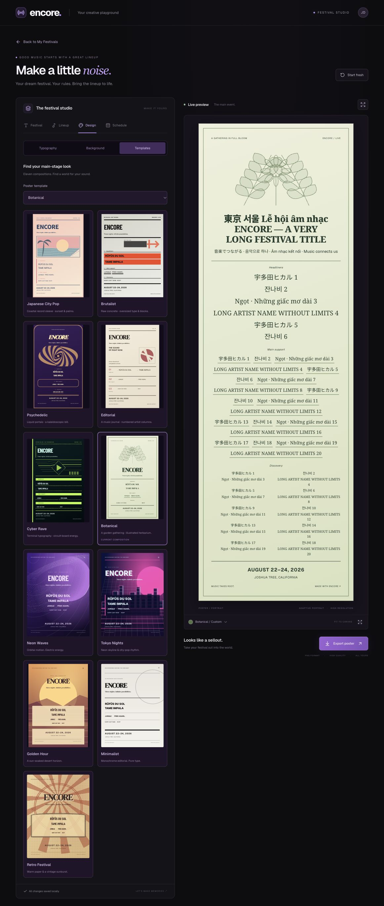
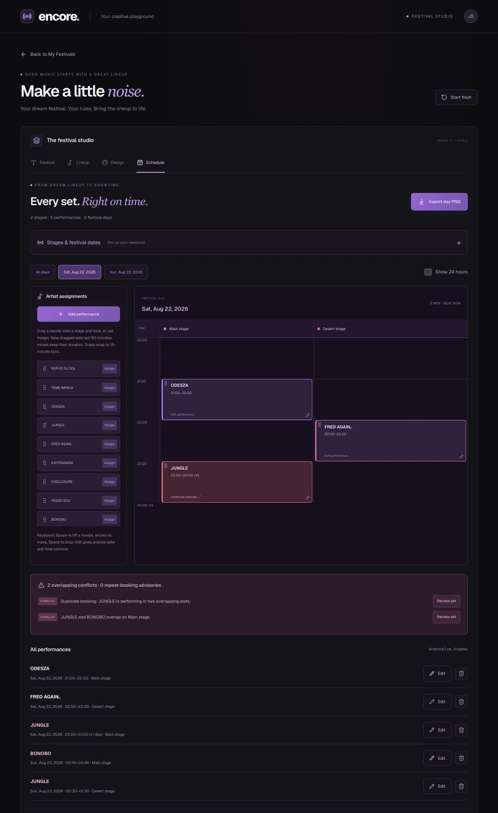
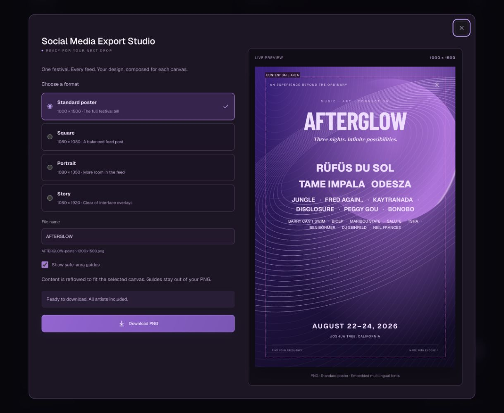
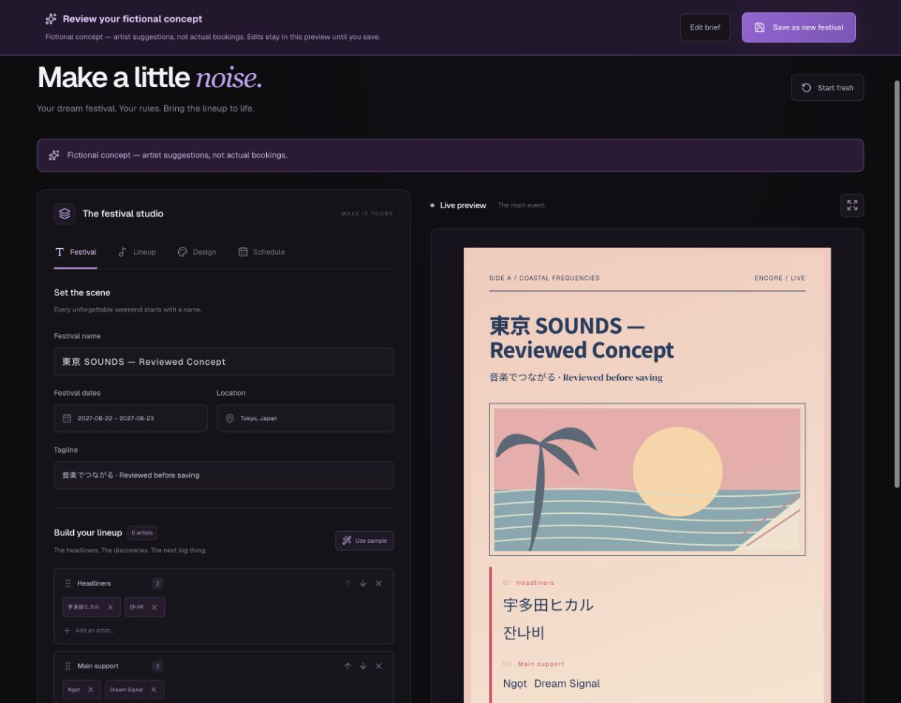
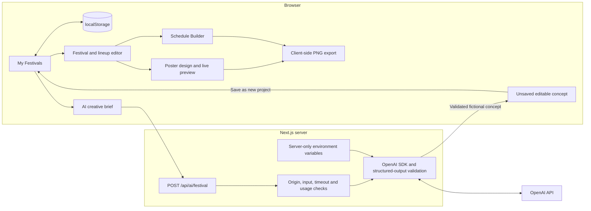

<div align="center">

# Encore

**Your dream festival. Your rules.**

A music festival concept studio for building lineups, designing posters, planning stages, and creating shareable artwork—with optional AI assistance.

[Get started](#installation) · [Explore the studio](#features) · [Configure AI](#openai-api-setup) · [Run checks](#testing)

</div>



> **Concepts, not confirmed events.** Encore is a creative planning tool. Festival concepts and sample lineups are fictional; artist appearances, bookings, affiliations, and endorsements are unconfirmed. AI-created projects carry a fictional-concept label in the editor and exported artwork.

## Overview

Encore combines a browser-local festival library with a responsive editor, an advanced poster design studio, and a multi-day schedule builder. Edit a lineup and see the poster respond immediately, then export artwork in poster or social formats. Optional server-side OpenAI integration turns a creative brief into an editable concept that you review before saving as a new project.

Manual editing, project storage, scheduling, and PNG exports work without an OpenAI key. Projects stay in the current browser; there are no accounts or cloud synchronization.

## Contents

- [Features](#features)
- [Screenshots](#screenshots)
- [Technology stack](#technology-stack)
- [Architecture](#architecture)
- [Installation](#installation)
- [Environment variables](#environment-variables)
- [OpenAI API setup](#openai-api-setup)
- [Usage](#usage)
- [Testing](#testing)
- [Deployment](#deployment)
- [Limitations](#limitations)
- [Roadmap](#roadmap)
- [Acknowledgments](#acknowledgments)

## Features

| Workspace | Implemented capabilities |
| --- | --- |
| **My Festivals** | Poster cards with festival details and artist counts; blank and sample projects; open, rename, duplicate, and delete; destructive-action confirmations and notifications. |
| **Festival & lineup editor** | Name, dates, location, tagline, and up to eight named lineup tiers; add/remove artists and reorder tiers; live poster preview and full-size view. |
| **Poster Design Studio** | Eleven composition-based templates, visual thumbnails, independent typography controls for titles/artists/taglines/details, color palettes, gradients, patterns, glow, grain, and decorative effects. |
| **Schedule Builder** | Multiple stages and days, stage colors and ordering, lineup or guest artists, exact-time forms, pointer/keyboard drag-and-drop, overnight sets, overlap warnings, and schedule PNGs. |
| **Social Media Export Studio** | Four exact PNG dimensions, live format preview, editable filenames, responsive artwork/lineup reflow, Story safe-area guides, and download fallbacks. |
| **AI Create** | Multilingual briefs, schema-validated festival concepts, optional schedules, loading/error states, editable unsaved review, and explicit save-as-new behavior. Requires server configuration. |

### Templates and typography

Each template has its own layout, artwork, hierarchy, and artist arrangement. Applying a template asks before replacing typography and background settings; festival details and artists remain available.

| Template | Visual direction |
| --- | --- |
| Neon Waves | Purple orbital waves and a centered festival bill |
| Tokyo Nights | Neon skyline and Japanese city-pop rhythm |
| Golden Hour | Warm desert horizon and sunset composition |
| Minimalist | Monochrome editorial typography |
| Retro Festival | Vintage paper and a sunburst |
| Japanese City Pop | Coastal record-sleeve composition, sunset, and palms |
| Brutalist | Concrete tones, oversized typography, and hard blocks |
| Psychedelic | Liquid portals and kaleidoscopic artwork |
| Editorial | Music-journal composition and numbered artist columns |
| Cyber Rave | Terminal-inspired typography and circuit artwork |
| Botanical | Illustrated herbarium and garden composition |

Font presets include modern sans-serif, condensed display, elegant serif, and Japanese/CJK-compatible stacks. Bundled poster fonts and script-aware fallbacks support Japanese, Korean, Vietnamese, and English content. Size, letter spacing, line height, and alignment can be adjusted separately for each text role. Long titles wrap, and export layouts fit content within the selected format; exceptionally dense designs can still require fewer artists or smaller text.

### Storage and compatibility

Projects, active-project selection, design settings, and schedules are stored in `localStorage` under `encore-projects-v1`. An existing `encore-festival-v1` draft is migrated while retaining the legacy copy. Missing design and schedule fields receive compatible defaults.

Malformed project storage gets a recovery copy under `encore-projects-recovery-*` when storage is writable. Unsupported newer storage versions are protected from overwrite. If storage is unavailable or full, the UI warns that changes are only in memory. Invalid saved schedules are preserved and require a confirmed reset before editing.

## Screenshots

These are actual local application captures using sample/test concepts. The editor above was captured from the current production build; the views below were captured while verifying their implemented features. Images are checked into this repository, so no external image host is required.

<details>
<summary><strong>Template gallery — eleven distinct poster designs</strong></summary>



</details>

<details>
<summary><strong>Schedule Builder — stages, overnight performances, and conflict warnings</strong></summary>



</details>

<details>
<summary><strong>Social Media Export Studio — formats, preview, and PNG download</strong></summary>



</details>

<details>
<summary><strong>AI Create — editable concept review before saving</strong></summary>



This captures the real review interface using a **mocked OpenAI response** during local testing. It does not represent a verified live, paid API generation.

</details>

## Technology stack

Versions below reflect the checked-in dependency lockfile.

| Layer | Technology |
| --- | --- |
| Application | Next.js 16.4.1 App Router, React 19.3.0, TypeScript 5.9.3 |
| Styling & icons | Tailwind CSS 4.3.3, CSS/SVG artwork, Lucide React |
| Interaction | dnd-kit for schedule drag-and-drop |
| Image export | `html-to-image` 1.11.13 with embedded poster fonts |
| AI | Official OpenAI JavaScript SDK 7.34.0, Responses API, Zod 4.6.7 |
| Persistence | Browser `localStorage`; no database |
| Quality checks | ESLint 9, TypeScript, Node's built-in test runner |

## Architecture



The main page is [`src/app/page.tsx`](src/app/page.tsx). Browser workspaces live in [`src/components`](src/components), with typed storage, design, scheduling, export, and AI contracts in [`src/lib`](src/lib). The only application API route is [`src/app/api/ai/festival/route.ts`](src/app/api/ai/festival/route.ts). The OpenAI key stays on the server; existing saved projects are not automatically uploaded.

## Installation

Use **Node.js 22.18 or newer** and npm. This supports the OpenAI SDK and the TypeScript-stripping flag used by the test command. A Node-capable environment is required for the optional AI endpoint.

```bash
git clone https://github.com/doselwon11/Encore.git
cd Encore
npm ci
npm run dev
```

Open [http://localhost:3000](http://localhost:3000). No environment file is needed for manual festival creation. The development and build scripts explicitly use Webpack, as configured in [`package.json`](package.json).

To run a production build locally:

```bash
npm run build
npm run start
```

To choose another port, use `npm run dev -- --port 3001` or `npm run start -- --port 3001`.

## Environment variables

Copy the credential-free example when enabling AI:

```bash
cp .env.example .env.local
```

| Variable | Default | Purpose |
| --- | --- | --- |
| `OPENAI_API_KEY` | Unset | Server-side OpenAI credential. Required only for AI Create. |
| `OPENAI_MODEL` | `gpt-4.1-mini` | Server-selected model; must support the Responses API and the structured output schema. |
| `AI_CREATE_ENABLED` | `false` | AI requests are enabled only when this is exactly `true` and a key is configured. |
| `APP_ORIGIN` | Request origin | Optional exact allowed application origin. Set the canonical HTTPS origin in production, without a trailing slash. |

See [`.env.example`](.env.example). `.env.local` and other `.env*` files are ignored; `.env.example` is intentionally tracked. Never put a credential in a `NEXT_PUBLIC_*` variable, a browser input, a screenshot, or a commit. Restart the server after changing local environment variables.

## OpenAI API setup

1. Create a key through the [OpenAI API dashboard](https://platform.openai.com/api-keys) and configure API billing/access in your own account.
2. Put the key in `OPENAI_API_KEY` in your private `.env.local`, or your hosting provider's server-side secret settings.
3. Keep `OPENAI_MODEL=gpt-4.1-mini` unless you have verified a compatible model. Set `AI_CREATE_ENABLED=true` for local testing.
4. Restart Encore, open **AI Create**, submit a brief, review the result, and choose **Save as new festival** when satisfied.
5. Keep public AI access disabled until the deployment protections described below are in place.

The server uses the official SDK's Responses API parsing and Zod-backed [structured outputs](https://developers.openai.com/api/docs/guides/structured-outputs). A second validation pass checks artist uniqueness, theme values, local schedule dates, and scheduling conflicts. Refusals, incomplete responses, invalid output, provider failures, and timeouts return errors instead of saving projects. Requests use `store: false`; consult OpenAI's data policies for provider-side handling rather than assuming zero retention.

### Input, cost, and abuse controls

The form accepts genres, favorite artists, location, start date, festival length (1–7 days), artist count (6, 12, 18, or 24), visual style, output language, additional direction, and an optional schedule. Fields have length limits; the route caps the body at 16,000 bytes. The model and output budget are server-selected, with a 4,000-token output cap and no automatic SDK retries.

Current controls include:

- Same-origin checks and a signed, HttpOnly, SameSite cookie for client identity.
- Three generation attempts per client per ten minutes; one concurrent request per client and two per server process.
- Global process limits of 20 attempts per hour and 100 per day; failed generation attempts also consume allowance.
- Upload, provider, generation, and browser timeouts; provider timeout is 45 seconds and route generation timeout is 50 seconds. The route declares a 60-second platform duration hint.

**These limits are in memory and are not sufficient for an unrestricted public deployment.** Restarts reset them, separate instances do not share them, and clearing cookies can bypass the per-client allowance. Add authentication, durable shared atomic limits and budgets, trusted-edge client identification, appropriate bot protection, monitoring, and provider spending controls before exposing paid generation publicly. Aborting a request may still incur provider usage.

## Usage

1. **Create a project.** From My Festivals, start blank or remix the sample. Open, rename, duplicate, or delete existing cards. Edits save locally; use **Back to My Festivals** to return to the library.
2. **Build the lineup.** Enter festival details, add artists to tiers, rename/reorder tiers, and watch the live poster. Use the sample lineup to explore quickly.
3. **Design the poster.** Open **Design**, choose a template, then adjust typography and background controls. Settings belong to that festival, including duplicated projects' independent copies.
4. **Plan the schedule.** Open **Schedule**, define festival days and stages, then assign lineup or guest artists. Drag cards to schedule in 15-minute increments, or use accessible add/edit forms for exact times. New dropped sets start at 60 minutes; moving a set preserves its duration.
5. **Handle overnight sets explicitly.** A 23:30–00:30 performance needs **Ends next day**. The builder stores festival-local dates/times, shows continuations, and detects overlaps across midnight. Stage overlaps and simultaneous duplicate artist bookings are errors; repeat appearances at different times produce advisories. Manual conflicts remain editable planning drafts and are marked in schedule exports.
6. **Export.** Use **Export poster** for the adaptive high-resolution poster, **Social Media Export Studio** for a fixed format, or schedule export for the selected/all-day timetable. Inspect the rendered result before sharing.
7. **Create with AI, optionally.** Describe a concept in your preferred language. Review and edit the unsaved result in the studio, then save it as a new festival. Leaving an unsaved generated review requires confirmation; generation never overwrites an existing project.

### Export formats

| Export | Output |
| --- | --- |
| Standard poster | 1000 × 1500 PNG |
| Square | 1080 × 1080 PNG |
| Portrait | 1080 × 1350 PNG |
| Story | 1080 × 1920 PNG |
| Existing adaptive poster export | Content-sized poster rendered at 3× scale |
| Schedule export | Selected/all days, 2× scale with a minimum 2400-pixel output width |

Social layouts reflow content rather than stretching or cropping the original poster. Story keeps 250-pixel top/bottom and 60-pixel side safe margins; preview guides are excluded from downloaded artwork. Fonts are loaded and embedded for PNG rendering. Overly dense layouts are warned about or blocked, and extremely tall schedules require a smaller day selection. A PNG is artwork, **not a restorable project backup**.

## Testing

Run all checks from the repository root:

```bash
npm test
npm run lint
npx tsc --noEmit
npm run build
```

There is no separate `typecheck` script. `npm test` uses Node's built-in runner and executes the TypeScript files in [`tests`](tests) without a separate compilation step.

The current 44-test suite covers project migration and persistence, design defaults, bundled multilingual font coverage, export sizing and filenames, scheduling conflicts and midnight behavior, and AI validation/error/limit/preview-to-project conversion paths. AI tests inject mock provider responses and do not spend API credits.

Browser verification performed during feature development includes editor/project flows, template previews, schedule interactions, and downloaded PNG dimensions/rendering across the eleven templates and four social formats. The screenshots above record real UI states. This repository does **not** currently include an automated browser end-to-end suite or CI workflow; unit tests do not replace visual export review. Live OpenAI generation still needs verification with your own configured API account.

Before publishing a change, follow [`AGENTS.md`](AGENTS.md): run lint, TypeScript checks, and a production build; review the diff and secrets; then commit and push only when checks pass. Never force-push.

## Deployment

Deploy as a **Next.js Node server** on a compatible managed host or your own Node environment:

```bash
npm ci
npm run build
npm run start
```

`next start` serves port 3000 by default and supports the `PORT` environment variable or `--port`. Configure environment variables in the hosting platform; keep the key server-side, set `APP_ORIGIN` to the deployed origin, and provide outbound access to the OpenAI API if AI is enabled. The build uses `next/font/google` for interface fonts, so it also needs access to the font provider; poster fonts are bundled locally.

Allow the AI handler sufficient execution time within your platform's limits. The `maxDuration` declaration is a hint, not a guarantee that every host allows a 60-second request. Keep `AI_CREATE_ENABLED=false` until shared abuse/cost protections are implemented. Manual editing remains usable when AI is disabled.

The current configuration uses Next.js cache components and partial prefetching, with Webpack build scripts. The full application includes a server API route and is **not configured for static-only export**. No Dockerfile, deployment pipeline, database provisioning, or production authentication is included.

Deploying to another domain or port creates a different browser storage origin. Existing local projects will not automatically appear there.

## Limitations

- **Local-only data:** no accounts, cloud sync, collaboration, project JSON import/export, or built-in backup/restore. Clearing site data can remove projects; deletion has no UI undo.
- **Concept planning:** no booking verification, ticketing, availability lookup, or connection to artist representatives. AI results can be inaccurate and require human review.
- **Festival-local time:** schedule timestamps are civil dates/times. The optional IANA timezone is a label; changing it does not convert performances, and the app does not resolve daylight-saving transitions or UTC instants.
- **Browser rendering:** large lineups, long multilingual content, memory limits, and font/rendering differences can affect PNG output. Export density guards favor readable layouts over unlimited content. No PDF, SVG, JPEG, or calendar export is implemented.
- **Language scope:** poster content supports the bundled Latin, Japanese, Korean, and Vietnamese fonts; the application interface is primarily English. Complete coverage of every script is not guaranteed.
- **AI operations:** requires a configured account and paid API access as applicable. Current limits are process-local, and live provider behavior has not been verified by the mocked tests or screenshots.

## Roadmap

Potential future work, **not implemented functionality**:

- [ ] Durable authenticated AI quotas, shared budgets, and operational monitoring.
- [ ] Portable project backup/import and optional account-based synchronization.
- [ ] Automated browser/export regression checks and CI.
- [ ] Calendar interchange and more explicit timezone/DST workflows.
- [ ] Additional export formats and broader interface localization.

## Acknowledgments

Built with [Next.js](https://nextjs.org), [React](https://react.dev), [Tailwind CSS](https://tailwindcss.com), [dnd kit](https://dndkit.com), [Lucide](https://lucide.dev), [html-to-image](https://github.com/bubkoo/html-to-image), [Zod](https://zod.dev), and the [official OpenAI JavaScript SDK](https://github.com/openai/openai-node).

Poster artwork is implemented with original CSS/SVG compositions. Bundled fonts include Geist, Barlow Condensed, DM Serif Display, Noto Sans JP, Noto Sans KR, and Noto Serif. Their license notices are included in [`public/fonts`](public/fonts): [Geist](public/fonts/Geist-LICENSE.txt), [Barlow Condensed](public/fonts/BarlowCondensed-LICENSE.txt), [DM Serif Display](public/fonts/DMSerifDisplay-LICENSE.txt), [Noto Sans JP](public/fonts/NotoSansJP-LICENSE.txt), [Noto Sans KR](public/fonts/NotoSansKR-LICENSE.txt), and [Noto Serif](public/fonts/NotoSerif-LICENSE.txt).

No repository-wide application license is currently included. Font licenses apply to their respective assets. Artist names in examples belong to their respective owners and do not imply participation or endorsement.
